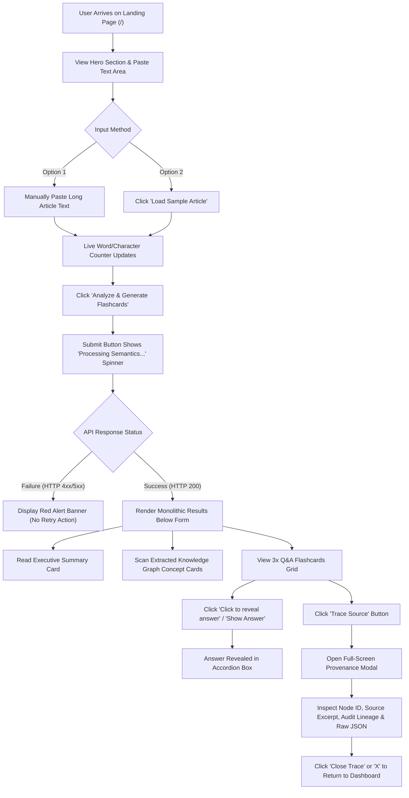
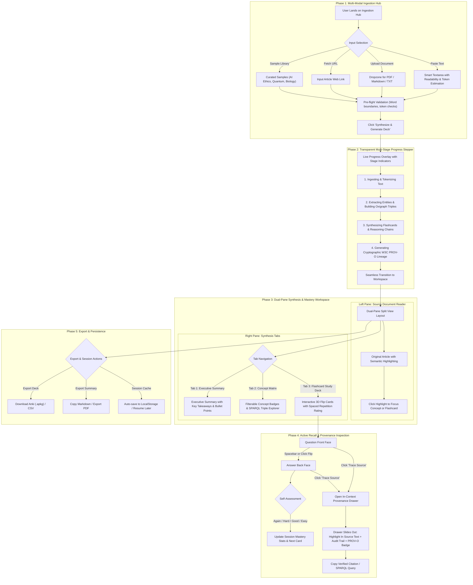

# SmartBrief — UX Evaluation & Improved User Flow Specification

**Role:** Senior UX Designer & Product Researcher  
**Issue:** SMAR-5 (Evaluate existing user journey and propose improved flow)  
**Date:** September 2026  
**Status:** In Review  

---

## Executive Summary

SmartBrief is an AI-powered article synthesis and knowledge extraction platform engineered with **FastAPI**, **Semantica**, embedded **Oxigraph RDF triplestores**, and **W3C PROV-O** decision provenance tracking. Its standout competitive advantage is **verifiable, hallucination-resistant knowledge synthesis**: every generated executive summary, knowledge concept, and Q&A flashcard is tied to an immutable provenance record with cryptographic audit trails and source document citations.

This document delivers:
1. **User Discovery & Context**: Persona profiles, primary user goals, and critical friction points.
2. **Current User Journey Mapping**: Step-by-step breakdown and Mermaid process diagram of the existing implementation.
3. **Comprehensive Usability Heuristic Evaluation**: An audit based on Jakob Nielsen’s 10 Usability Heuristics with severity ratings (0–4) and actionable critique.
4. **Proposed Improved User Flow & Architecture**: A redesign featuring a multi-modal ingestion hub, transparent processing stepper, dual-pane synthesis workspace, 3D flip flashcard study mode with spaced repetition, and an in-context provenance inspection drawer.
5. **Detailed Component Wireframes & UI/UX Specifications**: Layout blueprints, responsive specifications, keyboard navigation, and WCAG 2.1 AA accessibility standards.
6. **Discovery & Alignment Questions**: Strategic questions for the team to guide next sprint iterations.

---

## 1. User Discovery & Context

### 1.1 Target Personas

| Persona | Archetype | Core Needs & Goals | Pain Points with Current System |
| :--- | :--- | :--- | :--- |
| **Dr. Elena Vance** | Academic Researcher & Fact-Checker | Needs to digest dense preprints, verify AI claims without hallucination risk, and trace extracted concepts back to source paragraphs. | Current provenance modal isolates citations from paragraph context; cannot upload PDFs or fetch directly from arXiv/DOIs; cannot export citations to BibTeX/Zotero. |
| **Marcus Brody** | Lifelong Learner & Graduate Student | Needs active recall flashcards to prepare for exams, study key concepts, and test retention efficiently. | Current flashcards do not support deck study mode (card flipping, self-grading, spaced repetition); answers expand vertically, causing scroll fatigue; no export to Anki. |
| **Sarah Chen** | Tech & Policy Analyst | Needs fast, trustworthy executive summaries and structured concept relationship mappings for market intelligence reports. | Single-column endless scroll creates cognitive overload; cannot bookmark or save sessions (refreshing page wipes data); no quick markdown or PDF export. |

---

## 2. Current User Journey Mapping

### 2.1 Step-by-Step Current Flow Breakdown

1. **Discovery & Entry (`/`)**:
   - The user visits the single-page application.
   - A hero banner introduces the value proposition ("Synthesize Knowledge with Verifiable Provenance").
   - A single input card prompts the user to paste article text or click "Load Sample Article".
2. **Article Ingestion**:
   - The user inputs text via pasting into a single `textarea` or loads the hardcoded sample article.
   - Word and character counters update reactively.
   - The user clicks **Analyze & Generate Flashcards** (or Clear).
3. **Processing State (Black Box)**:
   - The submit button switches to a spinning icon with the label `"Processing Semantics..."`.
   - Textarea and buttons are disabled.
   - **Friction**: There is no progress feedback on the multi-step backend pipeline (tokenization, Oxigraph entity extraction, triple generation, flashcard synthesis, PROV-O cryptographic signing). For large texts taking 5–15 seconds, users experience uncertainty.
4. **Monolithic Results Display**:
   - The entire result set renders vertically below the form simultaneously.
   - Users must scroll through:
     - Executive Summary Card
     - Extracted Knowledge Graph Concepts Card (static 3-column grid of tags)
     - Interactive Q&A Flashcards Grid (3 cards)
   - **Friction**: High scroll fatigue; information is presented in a flat stack rather than an integrated workspace.
5. **Flashcard Interaction**:
   - Flashcards display question, category, and an accordion trigger ("Click to reveal answer" / "Show Answer").
   - Clicking expands the answer in a green container.
   - **Friction**: Breaks the mental model of physical flashcards (no front/back flip, no deck progression, no self-rating).
6. **Provenance Verification ("Trace Source")**:
   - User clicks `"Trace Source"` on a card, opening a centered modal dialog (`ProvenanceModal`).
   - The modal reveals: Linked Graph Node ID, Confidence %, Source Excerpt, Semantica Decision Audit Lineage, and an optional collapsible Raw JSON view.
   - User closes the modal via "Close Trace" or the "X" button.
   - **Friction**: The citation excerpt is floating in a modal; the user cannot see where in their original article text this excerpt originated.

### 2.2 Current User Flow Diagram (Mermaid.js)



---

## 3. Usability Heuristic Evaluation (Nielsen Norman Group)

We conducted a heuristic evaluation of SmartBrief using the 10 Jakob Nielsen Usability Heuristics, rated using the standard Severity Scale:
- **0 = Not a usability problem**
- **1 = Cosmetic problem only**
- **2 = Minor usability problem** (low priority fix)
- **3 = Major usability problem** (high priority fix)
- **4 = Usability catastrophe** (must fix before general release)

---

### Heuristic 1: Visibility of System Status
* **Rating:** **Severity 3 (Major)**
* **Finding**: During the analysis phase, the only visual cue is a spinning icon on the submit button (`Processing Semantics...`). 
* **Usability Impact**: The Semantica backend performs multiple distinct computational tasks: (1) NLP entity recognition, (2) Oxigraph RDF triple indexing, (3) Q&A flashcard generation, and (4) W3C PROV-O audit signature calculation. When processing large articles, this phase can take several seconds. Without a multi-stage stepper or estimated time, users perceive latency as an application hang and may repeatedly click or navigate away.
* **Recommendation**: Implement a multi-stage progressive status indicator ("1/4 Extracting Entities", "2/4 Building Triples", "3/4 Synthesizing Flashcards", "4/4 Signing Provenance").

---

### Heuristic 2: Match Between System and the Real World
* **Rating:** **Severity 2 (Minor)**
* **Finding**: The interface surfaces heavy technical jargon in primary UI views: `urn:smartbrief:concept:...`, `triplet_count`, `Oxigraph Embedded RDF Store`, `Semantica.Oxigraph.InferenceEngine`, and raw SHA256 checksums. Furthermore, the flashcard component uses an accordion toggle rather than a physical card metaphor.
* **Usability Impact**: Non-developer users (students, general readers) are intimidated by raw database URIs and technical nomenclature. Flashcard learners expect a tactile "flip" interaction that tests active recall before showing the answer.
* **Recommendation**: 
  - Adopt progressive disclosure: show clean, human-friendly badges by default (e.g. "Verified Source: Paragraph 2", "Concept: Artificial Intelligence") with a secondary "Advanced Technical Specs / SPARQL" tab.
  - Redesign flashcards with 3D flip card interactions and active recall self-grading ("Again", "Hard", "Good", "Easy").

---

### Heuristic 3: User Control and Freedom
* **Rating:** **Severity 3 (Major)**
* **Finding**: 
  1. Once submission starts, the user cannot cancel or abort an in-flight analysis.
  2. If the user refreshes the page or navigates away, all generated summaries, concepts, and flashcards are lost permanently (no session state or `localStorage` persistence).
  3. No ability to regenerate individual flashcards or edit generated answers.
  4. In the Provenance Modal, clicking outside the modal boundary dismisses it, but there is no keyboard shortcut legend or history breadcrumb.
* **Usability Impact**: High frustration if a user accidentally closes or reloads the tab after waiting for AI generation. Lack of cancellation leaves users stranded on long/stuck requests.
* **Recommendation**: Add a **Cancel** button during processing, auto-save the active session to `localStorage` with a "Clear / Start New" option, and support card regeneration.

---

### Heuristic 4: Consistency and Standards
* **Rating:** **Severity 2 (Minor)**
* **Finding**:
  - In `FlashcardItem.tsx`, there are two redundant triggers for revealing the answer: a text button `"Show Answer"` (line 47) and a dashed container `"Click to reveal answer"` (line 74).
  - Knowledge graph concept cards have hover effects (`hover:border-indigo-300 hover:shadow-md`) that suggest they are clickable links or filters, but clicking does nothing.
* **Usability Impact**: Confuses affordances. Users expect clickable-looking cards to filter flashcards or highlight concepts in the text.
* **Recommendation**: Unify flashcard reveal into a single prominent card-flip affordance. Make concept tags interactive filters that highlight corresponding sentences in the source text and filter related flashcards.

---

### Heuristic 5: Error Prevention
* **Rating:** **Severity 2 (Minor)**
* **Finding**: 
  - The textarea allows submission of arbitrary text lengths (from 1 character to hundreds of thousands of words) without client-side guidance on optimal length (e.g., minimum 100 words for meaningful triple extraction, maximum 5,000 words to avoid backend timeout).
  - No prompt warning before clearing entered text if the user clicks "Clear".
* **Usability Impact**: Submitting 5 words yields empty or malformed concepts; submitting huge documents triggers backend timeouts or truncations.
* **Recommendation**: Add real-time input health cues:
  - Minimum length threshold warning (< 50 words: "Article too short for semantic extraction").
  - Target range indicator (Optimal: 200–3,000 words).
  - Confirmation prompt on "Clear Article" if text exceeds 100 words.

---

### Heuristic 6: Recognition Rather than Recall
* **Rating:** **Severity 3 (Major)**
* **Finding**: In the `ProvenanceModal`, the user sees a single blockquote source excerpt out of context. The user must mentally recall where in their original article that excerpt was located.
* **Usability Impact**: Verifying provenance requires cognitive effort to re-scan the article. The promise of "transparent provenance" is diminished when the citation is divorced from its original surrounding text.
* **Recommendation**: Implement **in-context provenance highlighting**. When "Trace Source" is clicked, split the screen or open a side drawer: highlight the exact sentence/paragraph directly within the original article in the left pane, with visual breadcrumbs linking to the graph node.

---

### Heuristic 7: Flexibility and Efficiency of Use
* **Rating:** **Severity 3 (Major)**
* **Finding**:
  - Only one input method is supported: raw text pasting. No file upload (`.pdf`, `.md`, `.txt`) or URL article scraper.
  - No bulk actions for flashcards ("Reveal All Answers", "Reset Deck", "Study Mode").
  - No keyboard navigation shortcuts for power users (e.g. `Space` to flip card, `ArrowRight` for next card, `Esc` to close modal).
  - No export capabilities: users cannot export flashcards to Anki (`.apkg`/CSV), copy formatted Markdown, or save an executive summary PDF.
* **Usability Impact**: Repetitive clicking required for every card. High friction for students who already use spaced repetition software like Anki.
* **Recommendation**: Add multi-modal ingestion (File drag-and-drop, URL input), keyboard shortcuts, a dedicated Study Slideshow Mode, and 1-click Export to Anki / Markdown / PDF.

---

### Heuristic 8: Aesthetic and Minimalist Design
* **Rating:** **Severity 2 (Minor)**
* **Finding**: The results section stacks everything vertically in a single column: Executive Summary -> Knowledge Graph Concepts -> 3x Flashcards. On a standard laptop screen, the flashcards are pushed 1,200px below the fold.
* **Usability Impact**: Excessive vertical scrolling and visual clutter. Summary, graph, and cards compete for visual hierarchy rather than reinforcing each other.
* **Recommendation**: Transition from a vertical stack to a **Dual-Pane Workspace**:
  - Left Pane: Clean Source Article reader with interactive semantic entity highlights.
  - Right Pane: Tabbed synthesis hub (Tab 1: Executive Summary, Tab 2: Concept Knowledge Graph, Tab 3: Active Recall Flashcard Deck).

---

### Heuristic 9: Help Users Recognize, Diagnose, and Recover from Errors
* **Rating:** **Severity 2 (Minor)**
* **Finding**: When an API error occurs, a generic red alert box displays `errData.error || 'Server returned error status 500'`.
* **Usability Impact**: Doesn't tell the user what went wrong (e.g. network offline, backend unready, text formatting issue) or provide recovery actions.
* **Recommendation**: Display actionable error states with direct remediation:
  - "Backend Offline: Unable to reach Semantica service. [Retry Connection] [Use Offline Sample]"
  - "Text Unprocessable: Ensure text contains complete sentences. [Edit Text]"

---

### Heuristic 10: Help and Documentation
* **Rating:** **Severity 2 (Minor)**
* **Finding**: There are no introductory tooltips, onboarding guides, or contextual explanations of what "Semantica PROV-O", "Oxigraph Triples", or "Provenance Tracing" mean for a new user.
* **Usability Impact**: New users miss out on the core value proposition and wonder how "Trace Source" helps them.
* **Recommendation**: Include contextual info tooltips (icon `?` or `ℹ`) next to technical terms, plus a 2-step onboarding callout for first-time visitors ("1. Paste Article -> 2. Verify AI claims with zero hallucination").

---

## 4. Proposed Improved User Flow & Architecture

### 4.1 Redesigned User Journey Overview

The proposed design reorganizes SmartBrief into **five structured, seamless phases**:
1. **Phase 1: Multi-Modal Ingestion Hub** (Flexible input: Paste, File Upload, URL fetch, or Curated Sample library with real-time length guidance).
2. **Phase 2: Transparent Multi-Stage Progress Stepper** (Progressive live status showing tokenization, graph entity extraction, flashcard synthesis, and provenance signing).
3. **Phase 3: Dual-Pane Synthesis & Mastery Workspace** (Side-by-side synchronized interface: Left Pane = Document Reader with semantic highlights; Right Pane = Tabbed Synthesis Hub).
4. **Phase 4: Active Recall Study Deck & In-Context Provenance Drawer** (True 3D card flip, spaced repetition self-rating, and slide-out provenance drawer with simultaneous source document paragraph highlighting).
5. **Phase 5: Export & Session Continuity** (1-click Anki deck `.apkg` export, Copy Markdown, Print PDF, and automatic local storage persistence).

### 4.2 Improved Flow Diagram (Mermaid.js)



---

## 5. Detailed Wireframe Descriptions & Component UI/UX Specs

### 5.1 Wireframe 1: Ingestion Hub (Landing & Input Phase)

#### Layout Blueprint:
```
+-----------------------------------------------------------------------------------------+
| [Logo: SmartBrief]  [Provenance Verified Badge]           [History (3)] [Help] [Theme] |
+-----------------------------------------------------------------------------------------+
|                                                                                         |
|       Synthesize Knowledge with Verifiable Provenance                                   |
|       Turn articles into structured Oxigraph triples and active recall flashcards.      |
|                                                                                         |
|   +---------------------------------------------------------------------------------+   |
|   |  [ (•) Paste Text ]   [ ( ) Upload File (.pdf, .md) ]   [ ( ) Fetch Web URL ]   |   |
|   +---------------------------------------------------------------------------------+   |
|   |                                                                                 |   |
|   |   +-------------------------------------------------------------------------+   |   |
|   |   | Article Title (Optional): [ e.g. Quantum Computing Breakthroughs      ] |   |   |
|   |   +-------------------------------------------------------------------------+   |   |
|   |   | Textarea:                                                               |   |   |
|   |   | "Paste your article or research paper here..."                          |   |   |
|   |   |                                                                         |   |   |
|   |   |                                                                         |   |   |
|   |   |                                                                         |   |   |
|   |   +-------------------------------------------------------------------------+   |   |
|   |   | Words: 482 | Est. Read Time: 2 min | Readiness: Optimal (Green)         |   |   |
|   +---------------------------------------------------------------------------------+   |
|   |  Sample Library: [ Neuro-Symbolic AI ] [ Quantum Triples ] [ W3C PROV-O ]       |   |
|   |                                                                                 |   |
|   |  [ Clear Text ]                       [ Start Synthesis & Generate Deck (Cmd+↵) ]|   |
|   +---------------------------------------------------------------------------------+   |
+-----------------------------------------------------------------------------------------+
```

#### Key UI/UX Specifications:
- **Input Tabs**: 3 modes (Paste Text, File Upload drag-and-drop, Web URL fetch).
- **Article Title Input**: Optional dedicated field for cleaner document indexing and export filenames.
- **Dynamic Readiness Meter**: Real-time evaluation of text suitability:
  - *< 50 words*: Amber status ("Too short for robust concept extraction").
  - *100 – 4,000 words*: Emerald status ("Optimal for Semantica synthesis").
  - *> 6,000 words*: Blue status ("Long document — will summarize in chunks").
- **Sample Carousel**: Instead of 1 hardcoded button, provide 3 categorized domain samples (AI/Semantics, Biotech, Quantum).
- **Primary CTA**: Prominent high-contrast button with keyboard shortcut hint (`Cmd+Enter` / `Ctrl+Enter`).

---

### 5.2 Wireframe 2: Transparent Multi-Stage Progress Stepper

#### Layout Blueprint:
```
+--------------------------------------------------------------------+
|  Synthesizing Knowledge Graph & Provenance Lineage...              |
|  Estimated time: ~4 seconds                                        |
+--------------------------------------------------------------------+
|                                                                    |
|  [✓] 1. Ingesting & Tokenizing Semantic Context                    |
|      482 words validated • 18 sentence boundaries recognized       |
|                                                                    |
|  [⟳] 2. Extracting Entities & Building Oxigraph Triples  [Active]  |
|      Querying embedded Oxigraph store • 9 RDF triples mapped       |
|                                                                    |
|  [ ] 3. Synthesizing Flashcards & Active Recall Concepts [Pending] |
|      Targeting 3 core mastery domains                              |
|                                                                    |
|  [ ] 4. Generating Cryptographic W3C PROV-O Signatures  [Pending] |
|      Computing SHA256 audit hashes & entity derivations            |
|                                                                    |
|  +--------------------------------------------------------------+  |
|  | Progress: [████████████████░░░░░░░░░░░░░░░░░░░] 48%          |  |
|  +--------------------------------------------------------------+  |
|                                                  [ Cancel Task ]   |
+--------------------------------------------------------------------+
```

#### Key UI/UX Specifications:
- **Stepped Micro-Feedback**: Replaces the generic single spinner with 4 deterministic milestones.
- **Estimated Countdown**: Manages user perception of waiting time based on text word count.
- **Cancel Capability**: Allows user to abort processing without refreshing the browser.
- **Live Metric Counter**: Teases extracted triples and concepts as they are found.

---

### 5.3 Wireframe 3: Dual-Pane Workspace (Results Phase)

#### Layout Blueprint:
```
+-----------------------------------------------------------------------------------------+
| [SmartBrief] Document: "Neuro-Symbolic AI"  [Export Deck v] [Copy Summary] [New Article]|
+--------------------------------------------+--------------------------------------------+
| LEFT PANE: Source Document (Synchronized)  | RIGHT PANE: Synthesis & Study Deck         |
+--------------------------------------------+--------------------------------------------+
| [ Search in document...   ] [Highlight: On]| [ (•) Flashcards (3) ] [ Summary ] [ Graph]|
|                                            |                                            |
| The evolution of artificial intelligence   | +-- Flashcard Deck: Card 1 of 3 ---------+ |
| is entering a new paradigm powered by      | | Concept: Knowledge Graph [Verified]    | |
| ==semantic knowledge graphs== and neuro-   | |                                        | |
| symbolic reasoning. While large language   | | Q: What is the primary architectural   | |
| models excel at natural language under-    | |    role of a Knowledge Graph in        | |
| standing, they often suffer from           | |    Semantica?                          | |
| hallucinations...                          | |                                        | |
|                                            | | [ Click card or Space to Flip Answer ] | |
| [Paragraph 2]                              | |                                        | |
| >>> [PROVENANCE ANCHOR FOR CARD 1] <<<     | | [Node: concept:knowledge_graph]        | |
| "By extracting entities and semantic       | | [🔍 Trace Source]                      | |
| relationships into an RDF knowledge graph, | +----------------------------------------+ |
| intelligent agents can verify facts..."    | | Self-Grade: [Again] [Hard] [Good] [Easy]| |
|                                            | | Controls: [< Prev]  [Card 1/3]  [Next >]| |
| [Paragraph 3]                              | +----------------------------------------+ |
| Through dedicated provenance managers...   | Study Stats: 1 Mastered • 2 In Progress    |
+--------------------------------------------+--------------------------------------------+
```

#### Key UI/UX Specifications:
- **50/50 Split View (Desktop)** / **Stacked Tabs (Mobile)**: Eliminates scroll fatigue; users keep their primary context (the article) in view while interacting with AI-generated outputs.
- **Synchronized Visual Linking**: Selecting or hovering over a flashcard in the Right Pane automatically illuminates the corresponding provenance anchor in the Left Pane with a subtle pulsing highlight.
- **Workspace Utility Header**: Direct access to export options, markdown copy, and session reset.

---

### 5.4 Wireframe 4: Active Recall Flashcard Deck (Card Flip & Spaced Repetition)

#### Card Front (Question State):
```
+------------------------------------------------------------------------+
| Card 1 of 3 • Category: Data Architecture       [★ Bookmark] [Flip ↻]  |
+------------------------------------------------------------------------+
|                                                                        |
|  QUESTION:                                                             |
|  What is the primary architectural role of a Knowledge Graph in        |
|  Semantica?                                                            |
|                                                                        |
|                                                                        |
|  [ 💡 Click Card or Press Spacebar to Reveal Answer ]                  |
|                                                                        |
+------------------------------------------------------------------------+
| Linked Node: concept:knowledge_graph                 [🔍 Trace Source] |
+------------------------------------------------------------------------+
```

#### Card Back (Answer State with Self-Assessment):
```
+------------------------------------------------------------------------+
| Card 1 of 3 • Category: Data Architecture       [★ Bookmark] [Flip ↻]  |
+------------------------------------------------------------------------+
|                                                                        |
|  ANSWER:                                                               |
|  It serves as a deterministic semantic memory layer that models        |
|  explicit relationships between concepts and provides verifiable       |
|  ground truth for AI agents.                                           |
|                                                                        |
|  Rate your recall:                                                     |
|  [ (1) Again ]     [ (2) Hard ]       [ (3) Good ]       [ (4) Easy ]  |
|  < 1 min           10 min             1 day              3 days        |
|                                                                        |
+------------------------------------------------------------------------+
| Confidence: 95% • W3C PROV-O Validated               [🔍 Trace Source] |
+------------------------------------------------------------------------+
```

#### Key UI/UX Specifications:
- **3D Card Flip Motion**: CSS `transform: rotateY(180deg)` with `perspective: 1000px` gives physical feedback of turning a card over.
- **Active Recall Self-Grading**: Standard SuperMemo/Anki grading buttons (Again, Hard, Good, Easy) with hotkeys `1`, `2`, `3`, `4`.
- **Session Progress Bar**: Displays deck completion ("2/3 Reviewed", "Mastery: 67%").
- **Deck Controls**: Previous, Next, Shuffle, and "Study Mode Fullscreen".

---

### 5.5 Wireframe 5: Contextual In-Drawer Provenance Inspection

#### Layout Blueprint:
```
+-----------------------------------------------------------------------------------+
| Workspace Background (Dimmed)  | PROVENANCE & AUDIT TRAIL DRAWER              [X] |
+--------------------------------+--------------------------------------------------+
|                                | [🛡️ W3C PROV-O VERIFIED] [Confidence: 95%]       |
|                                |                                                  |
|                                | Flashcard: What is the primary architectural...  |
|                                |                                                  |
|                                | 1. EXACT SOURCE CITATION                         |
|                                | +----------------------------------------------+ |
|                                | | "By extracting entities and semantic         | |
|                                | | relationships into an RDF knowledge graph,   | |
|                                | | intelligent agents can verify facts..."      | |
|                                | +----------------------------------------------+ |
|                                | Located at Paragraph 2, Sentences 1-2            |
|                                | [ Jump to in Source Text ]                       |
|                                |                                                  |
|                                | 2. KNOWLEDGE GRAPH ANCHOR                        |
|                                | Node ID: urn:smartbrief:concept:knowledge_graph  |
|                                | Store: Oxigraph Triplestore (Embedded)           |
|                                | Triples: 9 Connected Entities                    |
|                                |                                                  |
|                                | 3. DECISION AUDIT LINEAGE                        |
|                                | (1) Tokenized semantic boundaries                |
|                                | (2) Linked node to Oxigraph triplestore          |
|                                | (3) Verified derivation with Semantica Manager   |
|                                |                                                  |
|                                | 4. CRYPTOGRAPHIC CHECKSUM                        |
|                                | SHA256: 5f9d07d9461ffff0... [Copy Hash]          |
|                                |                                                  |
|                                | [ (•) Human View ]  [ ( ) Raw JSON / SPARQL ]    |
|                                | [ Copy BibTeX / Citation ]      [ Close Drawer ] |
+--------------------------------+--------------------------------------------------+
```

#### Key UI/UX Specifications:
- **Slide-Out Drawer (Right Side)**: Replaces the disruptive center modal, allowing the user to view the source document and provenance inspection side-by-side.
- **"Jump to in Source Text" Action**: Scrolls and animates the highlight on the left pane source article.
- **Bilingual Presentation**:
  - *Human View* (Default): Plain-language explanation ("Verified from Paragraph 2 with 95% model confidence").
  - *Developer/Auditor View*: Raw W3C PROV-O JSON, Oxigraph SPARQL query, and SHA256 tamper-evident checksum.

---

## 6. Accessibility (WCAG 2.1 AA) & Design System Standards

### 6.1 Contrast & Color Tokens

| UI Element | Foreground Token | Background Token | Calculated Contrast | WCAG 2.1 AA Compliance |
| :--- | :--- | :--- | :--- | :--- |
| Primary Text | Slate-900 (`#0f172a`) | Slate-50 (`#f8fafc`) | **18.2:1** | Pass (Exceeds 4.5:1 AAA) |
| Secondary Text | Slate-600 (`#475569`) | White (`#ffffff`) | **5.4:1** | Pass (Exceeds 4.5:1 AA) |
| Primary Brand CTA | White (`#ffffff`) | Indigo-600 (`#4f46e5`) | **8.1:1** | Pass (Exceeds 4.5:1 AAA) |
| Provenance Badge | Emerald-800 (`#065f46`) | Emerald-100 (`#d1fae5`) | **7.3:1** | Pass (Exceeds 4.5:1 AAA) |
| Question Card Heading | Slate-900 (`#0f172a`) | White (`#ffffff`) | **19.1:1** | Pass (Exceeds 4.5:1 AAA) |

### 6.2 ARIA Semantics & Screen Reader Support
- **Progress Stepper**: Managed via `aria-live="polite"` so screen readers announce each milestone without jarring interruptions.
- **Flashcard Component**:
  - `role="region"` with `aria-label="Flashcard 1 of 3: Knowledge Graph"`.
  - Flip trigger marked with `aria-expanded="false|true"` and `aria-controls="flashcard-answer-1"`.
- **Provenance Drawer**:
  - `role="dialog"` with `aria-modal="true"`.
  - Accessible label `aria-labelledby="provenance-title"`.
  - Focus trapping enabled: Tab cycles exclusively within the drawer until dismissed; `Escape` key restores focus to the triggering "Trace Source" button.

### 6.3 Comprehensive Keyboard Shortcut Matrix

| Key Combination | Scope / Context | Action |
| :--- | :--- | :--- |
| `Cmd + Enter` / `Ctrl + Enter` | Ingestion Form | Submit article text and initiate synthesis. |
| `Space` / `Enter` | Flashcard Deck | Flip card between Question and Answer faces. |
| `ArrowRight` / `J` | Flashcard Deck | Advance to Next Flashcard. |
| `ArrowLeft` / `K` | Flashcard Deck | Return to Previous Flashcard. |
| `1`, `2`, `3`, `4` | Flashcard Answer Face | Rate recall difficulty (1: Again, 2: Hard, 3: Good, 4: Easy). |
| `T` | Focused Flashcard | Open Provenance Trace Drawer for the current card. |
| `Esc` | Modal / Drawer | Dismiss active Drawer or Modal and restore focus. |

---

## 7. Discovery & Clarification Questions for the Team

To align engineering, product, and design before implementation begins, we pose the following clarifying questions to the team:

1. **User Archetype Prioritization**:
   - Should our initial release optimize primarily for **Academic/Research Fact-Checkers** (prioritizing citation export, PDF ingestion, and deep SPARQL exploration) or for **Students/Learners** (prioritizing Anki deck export, mobile study modes, and gamified spaced repetition)?
2. **Backend Streaming / SSE Support**:
   - Can the FastAPI backend support Server-Sent Events (SSE) or WebSockets on `/api/process` to emit live progress milestones (e.g. `event: step_complete`, `data: { step: 2, label: "Oxigraph Triples Created" }`), or should the frontend simulate progress intervals based on text length?
3. **Multi-Modal Ingestion Scope**:
   - For Phase 1 enhancements, is backend file extraction (parsing `.pdf` or `.docx`) planned within the FastAPI container, or should the frontend handle client-side text extraction (e.g., using `pdfjs-dist`)?
4. **Session Persistence Architecture**:
   - Is client-side `localStorage` sufficient for persisting recent article summaries and flashcards, or is user authentication / database persistence (e.g. SQLite/PostgreSQL for user sessions) in the product roadmap?
5. **Flashcard Deck Customization**:
   - Would users benefit from configurable synthesis parameters (e.g., choosing flashcard count: 3 vs. 5 vs. 10; difficulty: Beginner vs. Deep Technical)?

---

## 8. Summary of Recommendations & Next Steps

| Phase | Milestone | Priority | Expected UX Impact |
| :--- | :--- | :--- | :--- |
| **P1** | **Multi-Modal Ingestion & Pre-flight Validation** | High | Eliminates blank-slate friction, prevents empty/timeout submissions, adds sample diversity. |
| **P2** | **Progressive Multi-Stage Stepper** | Critical | Eliminates perceived latency; builds trust by demonstrating active Semantica Oxigraph & PROV-O execution. |
| **P3** | **Dual-Pane Split Workspace** | High | Eliminates vertical scroll fatigue; creates cohesive relationship between source text and AI outputs. |
| **P4** | **3D Flip Study Deck with Spaced Repetition** | High | Delivers true active recall mechanics; increases user retention and daily active usage. |
| **P5** | **In-Context Provenance Drawer & Highlighting** | Critical | Delivers on the core brand promise of verifiable AI by linking citations directly into the source document. |
| **P6** | **Export Suite (Anki, Markdown, PDF)** | Medium | Integrates SmartBrief into real-world student and researcher study workflows. |

---
*Report delivered by Senior UX Designer.*
